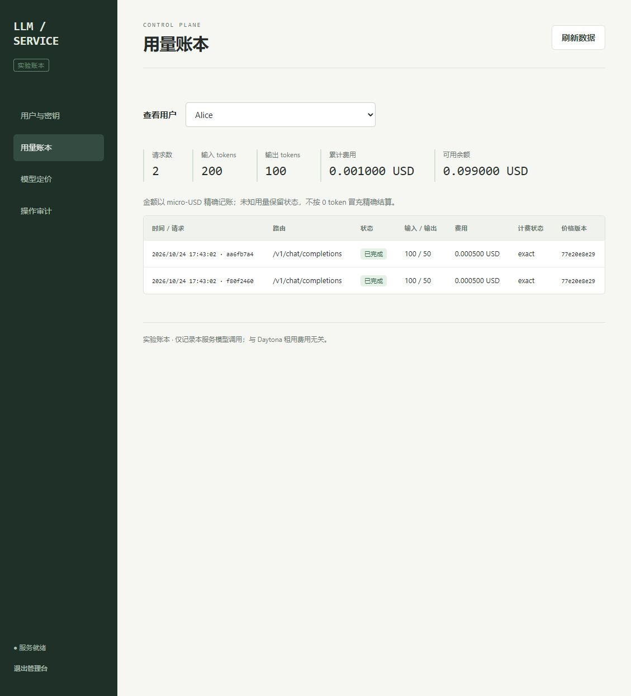

# LLM Service · Project 2

SGLang 模型服务工程：OpenAI 兼容网关、SSE、用户/API Key、实验计费账本、额度、Agent 工具调用、管理台、可重建部署与 GPU 机制实验。

**当前已验证 CPU 网关和账本；真实 GPU 部署、模型能力与性能目标尚待运行。** 固定 CPU fixture 输出不是模型推理成绩。[需求映射](docs/requirements-matrix.md) · [测试记录](docs/test-results.md) · [性能方法](docs/performance.md) · [来源](docs/sources.md)



## 当前证据

| 层次 | 结果 |
| --- | --- |
| 官方公开 18 项 HTTP checker | 本机 Windows 18/18，`results/cpu-soft-01/soft-report.json` |
| 深入 CPU 回归 | 19/19，`results/regression-03/report.json`；真实 HTTP、事务竞争、信号控制 SSE、取消和强制终止恢复 |
| HTTP-only 管理自测 | 5 组通过，4 类故障注入明确跳过，另由回归测试覆盖；`results/control-plane-mock-01.json` |
| Console 浏览器 | 用户创建、额度、余额、key 签发/轮换/撤销、停用、价格、账本、审计已操作；`results/console-browser/` |
| GitHub Actions / Linux | 以对应完整 commit 的 Actions 报告为准，本机结果不能代替 |
| 真实 SGLang / GPU 实验 / SLO | NOT_TESTED，已有代码入口，尚无 GPU 数值 |
| 正式评分 / 人工理解验收 | NOT_TESTED |

旧失败记录保留：`regression-01` 中断流清理失败，修复后 `regression-02` 16/16；增加边界后 `regression-03` 19/19。早期报告生成时没有 commit，`commit_sha=null` 保持原样。

## CPU 自测与预览

要求 Python **3.12**。Linux 使用 Bash；Windows 可用 Git Bash。独立环境不要求 Docker/systemd。

```bash
python -m venv .venv
.venv/bin/python -m pip install -r requirements.lock
.venv/bin/python scripts/check_local.py --out results/my-soft-run
.venv/bin/python scripts/run_tests.py --out results/my-regression-run
.venv/bin/python scripts/dev_demo.py
```

Windows 的解释器路径替换为 `.venv\Scripts\python.exe`。自测创建独立数据库和随机凭据，结束只停自己的进程，保留失败证据；每次使用新结果目录。官方 `soft_runner.py` 只在 GitHub-hosted runner 运行，本地入口使用未修改的 HTTP checker，不伪造 GitHub 环境。

预览只打印本机地址和私有控制文件路径。随机管理员 key 位于忽略的 `.runtime/preview/control.json`，与 DATA_DIR 分离，不提交。创建 `.runtime/preview/stop` 文件可停止预览并清理其控制文件。

## 配置与启动合同

私密值通过环境变量设置，`.env.example` 只有说明，程序不自动加载或输出密钥文件。

| 变量 | 用途 |
| --- | --- |
| API_KEY | ≥32 字符；普通 benchmark key，仍真实计费和限流 |
| ADMIN_API_KEY | 独立管理员 key；缺少时管理 API 关闭，无默认密码 |
| KEY_HASH_SECRET | ≥32 字符 HMAC pepper；同 DATA_DIR 必须一致，缺少/变更时拒绝启动 |
| DATA_DIR | 持久化目录，默认 `.runtime/data`；停止/重跑不删除 |
| HOST / PORT | 默认 `127.0.0.1:8000`；网关端口从环境读取 |
| ENGINE_BASE_URL | 内部 loopback 引擎，默认 `http://127.0.0.1:30001` |
| MODEL_ID / MODEL_REVISION | 固定模型与 revision，见下文 |
| BENCH_PROFILE | baseline / optimized |
| HF_HOME | 模型下载缓存，由依赖库读取 |

外部 CPU fixture 已启动时：

```bash
bash setup.sh --contract-test
bash setup.sh --contract-test
bash setup.sh --stop
```

contract-test 只替换模型引擎，鉴权、账本、配额、恢复代码与 live 相同，不安装 SGLang/CUDA/权重。`gateway.pid` 对应实际监听进程；`processes.json` 记录 PID 与创建时间，防止误杀复用 PID。配置/代码/私密配置摘要变化会重建自己的进程；同配置幂等保持 PID。

Linux RTX 4090：`BENCH_PROFILE=baseline bash setup.sh`，之后 `BENCH_PROFILE=optimized bash setup.sh`。live 使用 `.venv-gpu` 完整版本锁和独立 `.venv-bench` 客户端锁。SGLang 0.5.9 / PyTorch 2.9.1 / Transformers 4.57.1 的锁来自固定公开参考提交，本项目的 GPU 重建仍待验证。

## 请求与账本

```text
客户端 → Key 鉴权 → 用户额度 / 事务预占 → FIFO 有界排队
      → SGLang（同 request_id）→ JSON / 实时 SSE → usage 落盘 → 恰好一次结算
管理员 → /console → /admin/* → 同一 SQLite WAL 数据库
```

- `/healthz` 公共，依赖实际引擎就绪；其他模型/用量/指标接口需要 Bearer key。CPU `/info` 明确报告 cpu-fixture，不宣称 GPU 已部署。
- 支持 model/messages/temperature/max_tokens/stream/stream_options.include_usage/response_format；未知字段拒绝；JSON 模式原样转发，不修补答案。
- 用户和 key 由服务端鉴权确定。输入包含固定 chat template；CPU count 来自 fixture。客户端不能指定账单 usage、费用或角色。
- 整数 micro-USD；初始输入 2、输出 6，100+50 tokens 费用 500。余额检查和预占同一事务完成，多 key 共享用户总限额。
- 网关始终取得真实 usage，即使客户端不请求。最终 usage 立即 journal；正常 DONE 前结算。缺少 finish/usage/DONE 输出 error，不伪造成功。
- 断流/超时发送同 rid abort，关闭上游并释放槽位；AnyIO shield 保护清理不被重复取消。
- 无可信用量的中断先 pending_reconciliation；恢复 abort 后，以审计 credit_adjustment 释放预占，input/output/cost 保持 null，标 unknown_released。已有 journal 的用量恰好结算一次。
- Idempotency-Key 按 tenant+route+body hash 去重，进行中/已结束及 body 冲突返回 409。Agent 父账金额为 0，规划和最终回答分别形成模型调用子账。
- 原子零宽限轮换；已获准请求可按旧 key 完成，其后新请求 401。撤销/到期 401，停用 403，余额/token 不足 402，RPM/并发/队列满 429 + Retry-After。
- HTTP access log 关闭，校验错误不回显原输入。Console 的管理员凭据只在页面内存，不写 storage/cookie；所有管理写操作使用 Bearer header。

metrics 的 active/queued 为当前状态，累计计数在网关重启时清零，账本不清零。live 显存由 nvidia-smi 观察自有进程；不可观察时为 null。abort ACK 本身不证明 GPU 计算已经停止。

## 模块映射

| 模块 | 文件 |
| --- | --- |
| HTTP / 输入 / 管理 API | `server/app.py`、`models.py` |
| 引擎 / SSE / 生命周期 | `server/engine.py`、`streaming.py`、`service.py` |
| 准入 / 指标 | `server/admission.py`、`metrics.py` |
| Key / 配额 / 价格 / 账本 / 恢复 | `control_plane/storage.py`，共享单一事务边界 |
| 数据结构 | `migrations/001_initial.sql`，幂等执行 |
| 部署 / 进程 | `setup.sh`、`server/bootstrap.py`、`supervisor.py`、`main.py` |
| Agent / 管理台 | `agent/runner.py` / `console/` |
| 测试 / 故障控制 | `scripts/check_control_plane.py`、`tests/` |

## GPU 实验与压测

```bash
bash experiments/run.sh --case kv --out results/gpu-run-01/kv
bash experiments/run.sh --case prefix --out results/gpu-run-01/prefix
bash experiments/run.sh --case attention --out results/gpu-run-01/attention
BENCH_PROFILE=optimized bash setup.sh
```

实验会先停止本项目服务释放显存，之后可用 setup 恢复。KV 为固定 1.5B FP32 revision `989aa7980e4cf806f80c7fef2b1adb7bc71aa306`；最终服务与 prefix 为 7B BF16 revision `a09a35458c702b33eeacc393d103063234e8bc28`；attention 为合成张量。

```bash
.venv-gpu/bin/python scripts/download_tools.py --out tools/public-fresh-run
export LLM_LAB_TOOLS="$PWD/tools/public-fresh-run"
BENCH_PROFILE=baseline bash setup.sh
BENCH_PROFILE=baseline bash benchmarks/run.sh
BENCH_PROFILE=optimized bash setup.sh
BENCH_PROFILE=optimized bash benchmarks/run.sh
```

下载器校验完整九文件与 manifest，不自动推理。压测保持鉴权、额度、账本，使用相同 seed，原始记录和汇总写入 `results/serving`；后续新实验用公开 CLI 指定新的 `--out`。

```bash
python scripts/check_control_plane.py --base-url http://127.0.0.1:8000 --suite mock --out results/control-mock-new.json
python scripts/check_control_plane.py --base-url http://127.0.0.1:8000 --suite live --out results/control-live-new.json
```

HTTP-only 自测不申请 GPU，并明确列出无法注入的故障项；用 `scripts/run_tests.py` 验证这些项。live 另验证真实 Agent 规划与工具往返。push 只触发 CPU Actions；正式 GPU 评测需对已推送的完整 40 位 SHA 主动提交。所有自测不生成官方分数。

## 排障

healthz 503 时查看 DATA_DIR 内 engine/gateway 日志和模型身份。端口冲突时核对占用者，脚本不按端口杀无关进程。pepper 不一致时恢复原 KEY_HASH_SECRET，不删除数据库绕过。未知用量查 usage_state 和审计，释放预占不代表得到精确用量。GPU 安装/数值失败保留日志与原始数据，不改容差或复制旧结果。

运行数据库、私密环境、权重和 venv 均被 Git 忽略。公开仓库只放源代码、固定依赖、公开工具和脱敏证据。
